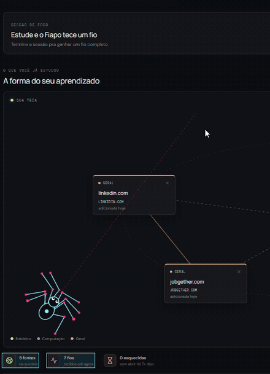

# Fiapo

<p align="center"></p>

Fiapo é um companheiro de estudo: uma aranhinha que anda pela tela e tece uma teia com tudo o que você estuda. Cada fonte que você dá pra ela vira um fio, e as patas dela acendem na cor da matéria de cada fonte.

- **Teia de fontes:** cole um link, dê um título e uma matéria. O Fiapo corre até a fonte nova e liga fontes da mesma matéria.
- **Humor:** animado se você estudou hoje, tranquilo se foi há pouco tempo e sonolento se faz dias que não estuda.
- **Revisão:** fontes que você não abre há 7 dias ficam esquecidas, e o Fiapo passeia mais por elas.
- **Sessão de foco:** escolha 15, 25 ou 50 minutos. O Fiapo tece um fio enquanto você estuda; se você desistir, o fio fica pela metade.
- **Acessórios:** lacinho, óculos e cachecol, que ele ganha conforme você estuda.

Tudo fica salvo no `localStorage` do navegador: não há login nem servidor.

**Experimente:** https://lilianmilan.github.io/fiapo/

## Rodar localmente

Precisa do Node.js 20.19+ ou 22.12+ (exigência do Vite 8).

```sh
npm install
npm run dev
```

O navegador abre sozinho em `http://localhost:5173`. Em modo de desenvolvimento, a Gaveta do Fiapo tem um botão "Liberar tudo (modo teste)" pra ver todos os acessórios.

## Estrutura

- `src/App.tsx`: tela principal (teia, foco e gaveta)
- `src/components/PageCrawler.tsx`: a aranha que anda, desenhada em canvas
- `src/components/Sidebar.tsx`: barra lateral com as matérias
- `src/fiapo/store.ts`: fontes, humor e cores das matérias
- `src/fiapo/focus.ts`: sessões de foco
- `src/fiapo/wardrobe.ts`: acessórios e conquistas
- `src/scene/`: reservado para uma futura cena em Three.js

## Comandos

- `npm run dev`: servidor de desenvolvimento
- `npm run build`: checa os tipos e gera o build em `dist/`
- `npm run lint`: roda o Oxlint
- `npm run preview`: abre o build de produção localmente
